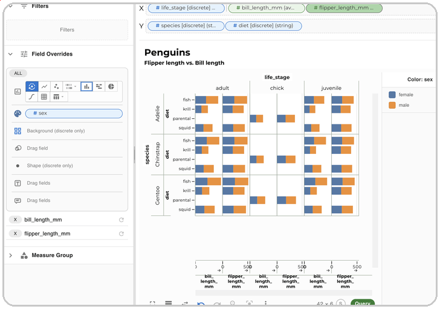

# Data Slicer - Data Analysis Platform (OLAP in Browser)

A modern data analysis platform that provides intuitive visualization and querying capabilities for multiple data sources including databases and files. It implements many aspects of the openly available [Polaris Formalism](https://graphics.stanford.edu/projects/polaris), later commercially productized as [Tableau (Salesforce)](https://www.tableau.com).

<br />

<p align="center">
  
</p>

<br />

## Quick start

Run your own server with a single command — all you need afterwards is a browser. Requires [Docker](https://docs.docker.com/get-docker/) on macOS or Linux:

```bash
curl -fsSL https://datafeta.io/install.sh | sh
```

Then open <http://localhost:8100>. Re-run the command to upgrade; add `-s -- --uninstall` after `sh` to remove it. The server listens on localhost only by default (see the [script](https://datafeta.io/install.sh) for options such as `DATAFETA_PORT`).

Just want a look? A **stripped-down demo** (restricted features) is online at [app.datafeta.io](https://app.datafeta.io) — more at [datafeta.io](https://datafeta.io).

## Overview

Data Slicer is available in two ways:

1. **Web app** — React frontend + FastAPI backend, deployed with Docker. Good for shared / remote data, large datasets and team deployments.
2. **Desktop app** — standalone Qt app (Windows / macOS / Linux) with a bundled local backend. No server setup; data stays on your machine. See [`desktop/README.md`](./desktop/README.md). Trade-off: it is single-user and large datasets are processed on your own PC.

## Key features

- **Many data sources** — CSV, Parquet, JSON/NDJSON, Excel, SQLite, ClickHouse, Hive Parquet, Kaggle and HuggingFace datasets
- **Drag-and-drop charts** — built on Observable Plot, with automatic chart-type detection
- **Faceting** — small multiples for multi-dimensional exploration
- **Filters & computed fields** — discrete, continuous and date filters, virtual columns, joins and unions
- **Multi-sheet workspaces** — save/load configurations and share snapshots
- **Fast** — DuckDB WASM column caching in the browser, Arrow transport, query optimization in the backend

Details: [user manual](./docs/index.md) and [data source reference](./docs/reference/data-sources.md).

## Docker

Run the pre-built image directly:

```bash
docker run -p 8000:8000 ghcr.io/henrywiechert/data-slicer
```

Open <http://localhost:8000>. The API is served under `/api/v1`.

To build from source with Docker Compose, copy [`.env.example`](.env.example), adjust it, then:

```bash
cp .env.example .env
./build-docker.sh
docker compose --env-file .env up
```

Separate frontend hosting, reverse proxy setups, side-by-side flavours and environment variables are covered in [`docs/reference/deployment.md`](./docs/reference/deployment.md).

## Documentation

- [User manual](./docs/index.md) (MkDocs sources in [`docs/`](./docs))
- [`backend/`](./backend/README.md) — backend API and service internals
- [`frontend/`](./frontend/README.md) — frontend internals, incl. [Arrow transport](./frontend/ARROW.md) and [DuckDB WASM caching](./frontend/DUCKDB_WASM.md)

## Contributing

See [`CONTRIBUTING.md`](./CONTRIBUTING.md) for development setup, coding standards and the CLA.

## License

Licensed under the GNU Affero General Public License v3.0 only — see [`LICENSE`](./LICENSE). Contributions are accepted only under the terms in [`CLA.md`](./CLA.md) or [`CLA_CORPORATE.md`](./CLA_CORPORATE.md); pull requests must pass the CLA check before merge.
